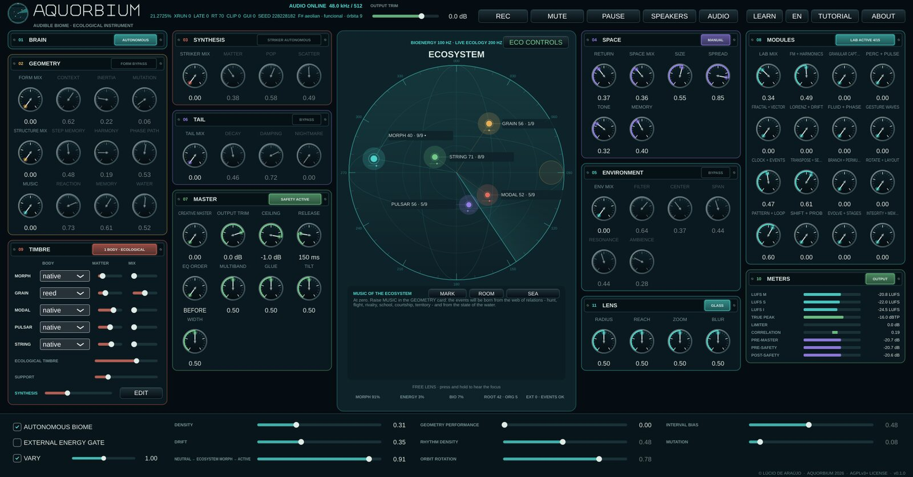

# Aquorbium



**Download:** [releases](https://github.com/lucioaraujo/aquorbium/releases) ·
**Install:** [`INSTALL.md`](INSTALL.md) ·
**Contact:** **rasgo.instruments@gmail.com**

Languages:

- [English](#english)
- [Português](#português)
- [Français](#français)
- [Español](#español)

---

## English

**An audible biome.** Five sound organisms - MORPH, GRAIN, MODAL, PULSAR and
STRING - live in a sphere of water. They see and hear each other through the
water, hunt, flee, court, defend territory, are born and die, and sing. You do
not play notes: you play the environment, and listen to what the life inside
makes of it.

**Authorship:** Lúcio de Araújo · **Family:** [RASGO](https://rasgoinstruments.arquiviagem.net/) ·
**Version:** v0.1.0 · **License:** GNU AGPL-3.0-or-later (see
[`LICENSE-AGPL-3.0.txt`](LICENSE-AGPL-3.0.txt) and
[`CREDITS_AND_SOURCES.md`](CREDITS_AND_SOURCES.md))

### What it is

- **Every opening is another piece.** The session's seed draws a world - a
  key and a mode, a harmonic language (functional, modal, Brazilian,
  impressionist, chromatic) with modulations and polytonal episodes, an arc
  of tension - and a biome: the water's temperature and light, its
  turbidity and current, the population, which modules wake, each
  organism's body.
- **The music comes from the ecosystem.** A hunter imitates what it heard of
  its prey; rivals answer in hocket; a courting pair copies each other's
  song; conflicts become harmonic tension and resolve into cadences. Songs
  pass from organism to organism, like the songs of whales.
- **The water is the form.** Ice, cold, temperate, turbulent and boiling
  water are five ways of playing, and the sea absorbs the highs with
  distance.
- **Each organism has a synthesis voice** you can build - two sources, a
  filter, envelopes, LFOs - and a matrix where the ecosystem's life
  (hunger, tension, distance, the temperature of the water) plays the
  parameters.

### How you use it

1. Open it and listen: with **AUTONOMOUS BIOME** on, it lives by itself.
2. **VARY** (bottom strip) moves the controls slowly over the music's time,
   around where the seed or your hand left them; its slider sets how far.
3. Each card's first control is its amount in the mix: **raise the door
   first**, then the other controls.
4. **TUTORIAL** explains the instrument chapter by chapter, and **LEARN**
   explains any control you point at.
5. **ECO CONTROLS**, inside the aquarium, keeps **scenes**; **REC** records
   what you hear; **HEADPHONES** places each organism around your head.

Everything in the Aquorbium is slow on purpose: give each gesture a minute.

### Download

Windows (installer and portable `.zip`), macOS (Universal 2) and Linux
(`.deb`, AppImage, `.tar.gz`) on the
[releases page](https://github.com/lucioaraujo/aquorbium/releases). The
first opening shows a security warning on Windows and macOS; it is expected,
and [`INSTALL.md`](INSTALL.md) says where to click.

### Build from source

```sh
git clone https://github.com/lucioaraujo/aquorbium.git
git clone --branch 9.0.3 https://github.com/juce-framework/JUCE.git
cmake -S aquorbium -B aquorbium/build -DCMAKE_BUILD_TYPE=Release -DAQUORBIUM_JUCE_PATH=$PWD/JUCE
cmake --build aquorbium/build --parallel 2
(cd aquorbium/build && ctest -LE slow --output-on-failure)
```

The development journal, with every module, decision and measurement, is in
[`docs/DESENVOLVIMENTO.md`](docs/DESENVOLVIMENTO.md) (in Portuguese); each
module has its own `*_DESIGN.md` beside the code.

---

## Português

**Um bioma audível.** Cinco organismos sonoros - MORPH, GRAIN, MODAL, PULSAR
e STRING - vivem numa esfera de água. Eles se veem e se ouvem através da
água, caçam, fogem, cortejam, defendem território, nascem e morrem, e
cantam. Você não toca notas: toca o ambiente, e escuta o que a vida lá
dentro faz com ele.

**Autoria:** Lúcio de Araújo · **Família:** [RASGO](https://rasgoinstruments.arquiviagem.net/) ·
**Versão:** v0.1.0 · **Licença:** GNU AGPL-3.0-or-later (ver
[`LICENSE-AGPL-3.0.txt`](LICENSE-AGPL-3.0.txt) e
[`CREDITS_AND_SOURCES.md`](CREDITS_AND_SOURCES.md))

### O que é

- **Cada abertura é uma peça nova.** A semente da sessão sorteia um mundo -
  uma tonalidade e um modo, uma linguagem harmônica (funcional, modal,
  brasileira, impressionista, cromática) com modulações e episódios
  politonais, um arco de tensão - e um bioma: a temperatura e a luz da
  água, a turbidez e a correnteza, a população, quais módulos acordam, o
  corpo de cada organismo.
- **A música nasce do ecossistema.** O caçador imita o que ouviu da presa;
  os rivais respondem em hoquetus; o par em cortejo copia o canto do outro;
  os conflitos viram tensão harmônica e resolvem em cadências. Os cantos
  passam de organismo a organismo, como os cantos das baleias.
- **A água é a forma.** Gelo, fria, temperada, turbulenta e fervura são
  cinco maneiras de tocar, e o mar absorve os agudos com a distância.
- **Cada organismo tem uma voz de síntese** que você pode construir - duas
  fontes, filtro, envelopes, LFOs - e uma matriz em que a vida do
  ecossistema (fome, tensão, distância, a temperatura da água) toca os
  parâmetros.

### Como se usa

1. Abra e escute: com **BIOMA AUTÔNOMO** ligado, ele vive sozinho.
2. O **VARIA** (faixa de baixo) move os controles devagar ao longo da
   música, em torno de onde a semente ou a sua mão os deixou; o slider dele
   diz quanto.
3. O primeiro controle de cada cartão é a quantidade dele na mistura:
   **suba a porta primeiro**, depois os outros.
4. O **TUTORIAL** explica o instrumento capítulo por capítulo, e o **LEARN**
   explica qualquer controle que você apontar.
5. **COMANDOS ECO**, dentro do aquário, guarda **cenas**; **REC** grava o que
   você ouve; **FONES** põe cada organismo em volta da sua cabeça.

Tudo no Aquorbium é lento de propósito: dê um minuto a cada gesto.

### Download

Windows (instalador e `.zip` portátil), macOS (Universal 2) e Linux (`.deb`,
AppImage, `.tar.gz`) na
[página de releases](https://github.com/lucioaraujo/aquorbium/releases). Na
primeira abertura, Windows e macOS mostram um aviso de segurança; é esperado,
e o [`INSTALL.md`](INSTALL.md) diz onde clicar.

### Compilar a partir do código

```sh
git clone https://github.com/lucioaraujo/aquorbium.git
git clone --branch 9.0.3 https://github.com/juce-framework/JUCE.git
cmake -S aquorbium -B aquorbium/build -DCMAKE_BUILD_TYPE=Release -DAQUORBIUM_JUCE_PATH=$PWD/JUCE
cmake --build aquorbium/build --parallel 2
(cd aquorbium/build && ctest -LE slow --output-on-failure)
```

O diário de desenvolvimento, com cada módulo, decisão e medição, está em
[`docs/DESENVOLVIMENTO.md`](docs/DESENVOLVIMENTO.md); cada módulo tem o seu
`*_DESIGN.md` ao lado do código.

---

## Français

**Un biome audible.** Cinq organismes sonores - MORPH, GRAIN, MODAL, PULSAR et
STRING - vivent dans une sphère d'eau. Ils se voient et s'entendent à travers
l'eau, chassent, fuient, paradent, défendent un territoire, naissent et
meurent, et chantent. Vous ne jouez pas de notes : vous jouez
l'environnement, et écoutez ce que la vie à l'intérieur en fait.

**Auteur :** Lúcio de Araújo · **Famille :** [RASGO](https://rasgoinstruments.arquiviagem.net/) ·
**Version :** v0.1.0 · **Licence :** GNU AGPL-3.0-or-later (voir
[`LICENSE-AGPL-3.0.txt`](LICENSE-AGPL-3.0.txt) et
[`CREDITS_AND_SOURCES.md`](CREDITS_AND_SOURCES.md))

### Ce que c'est

- **Chaque ouverture est une nouvelle pièce.** La graine de la session tire
  un monde - une tonalité et un mode, un langage harmonique (fonctionnel,
  modal, brésilien, impressionniste, chromatique) avec des modulations et
  des épisodes polytonaux, un arc de tension - et un biome : la température
  et la lumière de l'eau, sa turbidité et son courant, la population, les
  modules qui s'éveillent, le corps de chaque organisme.
- **La musique naît de l'écosystème.** Le chasseur imite ce qu'il a entendu
  de sa proie ; les rivaux se répondent en hoquet ; le couple en parade
  copie le chant de l'autre ; les conflits deviennent tension harmonique et
  se résolvent en cadences. Les chants passent d'un organisme à l'autre,
  comme les chants des baleines.
- **L'eau est la forme.** Glace, froide, tempérée, turbulente et en
  ébullition : cinq manières de jouer, et la mer absorbe les aigus avec la
  distance.
- **Chaque organisme a une voix de synthèse** que vous pouvez construire -
  deux sources, un filtre, des enveloppes, des LFO - et une matrice où la vie
  de l'écosystème (la faim, la tension, la distance, la température de
  l'eau) joue les paramètres.

### Comment s'en servir

1. Ouvrez-le et écoutez : avec **BIOME AUTONOME** activé, il vit tout seul.
2. **VARIE** (bande du bas) bouge lentement les commandes au fil de la
   musique, autour de là où la graine ou votre main les a laissées ; son
   curseur règle jusqu'où.
3. La première commande de chaque carte est sa part dans le mélange :
   **montez d'abord la porte**, puis les autres commandes.
4. **TUTORIEL** explique l'instrument chapitre par chapitre, et **LEARN**
   explique toute commande que vous pointez.
5. **COMMANDES ÉCO**, dans l'aquarium, garde des **scènes** ; **REC**
   enregistre ce que vous entendez ; **CASQUE** place chaque organisme
   autour de votre tête.

Tout dans l'Aquorbium est lent à dessein : accordez une minute à chaque geste.

### Téléchargement

Windows (installateur et `.zip` portable), macOS (Universal 2) et Linux
(`.deb`, AppImage, `.tar.gz`) sur la
[page des versions](https://github.com/lucioaraujo/aquorbium/releases). À la
première ouverture, Windows et macOS affichent un avertissement de sécurité ;
c'est attendu, et [`INSTALL.md`](INSTALL.md) dit où cliquer.

### Compiler depuis les sources

```sh
git clone https://github.com/lucioaraujo/aquorbium.git
git clone --branch 9.0.3 https://github.com/juce-framework/JUCE.git
cmake -S aquorbium -B aquorbium/build -DCMAKE_BUILD_TYPE=Release -DAQUORBIUM_JUCE_PATH=$PWD/JUCE
cmake --build aquorbium/build --parallel 2
(cd aquorbium/build && ctest -LE slow --output-on-failure)
```

Le journal de développement, avec chaque module, décision et mesure, est dans
[`docs/DESENVOLVIMENTO.md`](docs/DESENVOLVIMENTO.md) (en portugais) ; chaque
module a son `*_DESIGN.md` à côté du code.

---

## Español

**Un bioma audible.** Cinco organismos sonoros - MORPH, GRAIN, MODAL, PULSAR y
STRING - viven en una esfera de agua. Se ven y se oyen a través del agua,
cazan, huyen, cortejan, defienden territorio, nacen y mueren, y cantan. Usted
no toca notas: toca el ambiente, y escucha lo que la vida de dentro hace con
él.

**Autoría:** Lúcio de Araújo · **Familia:** [RASGO](https://rasgoinstruments.arquiviagem.net/) ·
**Versión:** v0.1.0 · **Licencia:** GNU AGPL-3.0-or-later (ver
[`LICENSE-AGPL-3.0.txt`](LICENSE-AGPL-3.0.txt) y
[`CREDITS_AND_SOURCES.md`](CREDITS_AND_SOURCES.md))

### Qué es

- **Cada apertura es una pieza nueva.** La semilla de la sesión sortea un
  mundo - una tonalidad y un modo, un lenguaje armónico (funcional, modal,
  brasileño, impresionista, cromático) con modulaciones y episodios
  politonales, un arco de tensión - y un bioma: la temperatura y la luz del
  agua, su turbidez y su corriente, la población, qué módulos despiertan, el
  cuerpo de cada organismo.
- **La música nace del ecosistema.** El cazador imita lo que oyó de su presa;
  los rivales se responden en hoquetus; la pareja en cortejo copia el canto
  del otro; los conflictos se vuelven tensión armónica y se resuelven en
  cadencias. Los cantos pasan de organismo a organismo, como los cantos de
  las ballenas.
- **El agua es la forma.** Hielo, fría, templada, turbulenta y en hervor:
  cinco maneras de tocar, y el mar absorbe los agudos con la distancia.
- **Cada organismo tiene una voz de síntesis** que usted puede construir -
  dos fuentes, un filtro, envolventes, LFO - y una matriz en la que la vida
  del ecosistema (el hambre, la tensión, la distancia, la temperatura del
  agua) toca los parámetros.

### Cómo se usa

1. Ábralo y escuche: con **BIOMA AUTÓNOMO** activado, vive solo.
2. **VARÍA** (franja de abajo) mueve despacio los controles a lo largo de la
   música, alrededor de donde la semilla o su mano los dejó; su deslizador
   dice cuánto.
3. El primer control de cada tarjeta es su cantidad en la mezcla: **suba
   primero la puerta**, después los demás controles.
4. **TUTORIAL** explica el instrumento capítulo a capítulo, y **LEARN**
   explica cualquier control que usted señale.
5. **CONTROLES ECO**, dentro del acuario, guarda **escenas**; **REC** graba
   lo que oye; **AURICULARES** coloca cada organismo alrededor de su cabeza.

Todo en el Aquorbium es lento a propósito: dé un minuto a cada gesto.

### Descarga

Windows (instalador y `.zip` portátil), macOS (Universal 2) y Linux (`.deb`,
AppImage, `.tar.gz`) en la
[página de versiones](https://github.com/lucioaraujo/aquorbium/releases). En
la primera apertura, Windows y macOS muestran un aviso de seguridad; es
esperable, y [`INSTALL.md`](INSTALL.md) dice dónde hacer clic.

### Compilar desde el código

```sh
git clone https://github.com/lucioaraujo/aquorbium.git
git clone --branch 9.0.3 https://github.com/juce-framework/JUCE.git
cmake -S aquorbium -B aquorbium/build -DCMAKE_BUILD_TYPE=Release -DAQUORBIUM_JUCE_PATH=$PWD/JUCE
cmake --build aquorbium/build --parallel 2
(cd aquorbium/build && ctest -LE slow --output-on-failure)
```

El diario de desarrollo, con cada módulo, decisión y medición, está en
[`docs/DESENVOLVIMENTO.md`](docs/DESENVOLVIMENTO.md) (en portugués); cada
módulo tiene su `*_DESIGN.md` junto al código.
